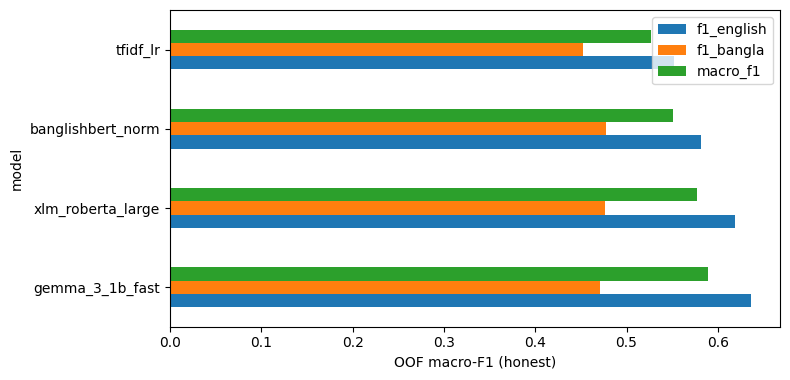
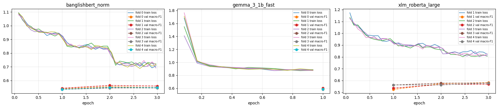

# HerWILL Safe Social Media Datathon 2026 - Harmful Language Classification

**Author:** Maisha

> **Content warning:** this project works with real social-media posts that contain hate speech, slurs, harassment and other offensive language in Bangla, English and Banglish. The data files in `data/`, and some printed examples in the notebook (sections 1, 2 and 9), show this text unfiltered. Please take care when reading them.

This package contains the complete, runnable code for our final Kaggle submission. It classifies Bangla, English and Banglish social-media posts into three classes:

| Label | Meaning |
|---|---|
| 0 | Explicitly Toxic / Hateful |
| 1 | Subtly Toxic |
| 2 | Non-toxic / Neutral |

**Final submission:** an ensemble of four models (TF-IDF + logistic regression, XLM-RoBERTa large, BanglishBERT, Gemma 3 1B with LoRA).
**Honest cross-validation Macro F1: 0.6057** (5 folds: 0.608 / 0.613 / 0.602 / 0.602 / 0.602).

---

## Contents of this README

1. What is in this package
2. Quick start (5 steps)
3. Detailed setup and what to expect
4. How to check the result
5. Quick code check without a GPU (a few minutes)
6. How the pipeline works
7. Models and hyperparameters
8. Results
9. Data and rules compliance
10. Reproducibility notes
11. Troubleshooting
12. Limitations

---

## 1. What is in this package

```
HerWILL_Datathon_2026/
├── README.md                  <- this file
├── requirements.txt           <- package versions (installed automatically by the notebook)
├── .gitignore
├── datathon.ipynb             <- the main notebook: runs everything, from raw data to the submission
├── figures/                   <- charts used in this README (taken from the notebook's outputs)
│   ├── model_comparison.png
│   └── loss_curves.png
├── src/                       <- the scripts the notebook runs (also written by the notebook itself)
│   ├── common.py              <- shared code: paths, seed, text cleaning, metric, file helpers
│   ├── prepare_data.py        <- drops the outlier, merges duplicates, builds the 5 folds
│   ├── train_tfidf.py         <- baseline: TF-IDF + logistic regression
│   ├── train_transformer.py   <- fine-tunes XLM-R large, BanglishBERT and Gemma (one script for all)
│   ├── ensemble.py            <- combines the models; tunes weights honestly; writes the submission
│   ├── make_soft_labels.py    <- optional experiment, switched OFF
│   └── id_neighbours.py       <- optional experiment, switched OFF, not used
├── data/
│   ├── train.csv              <- competition training data (see section 9)
│   ├── test.csv               <- competition test data (see section 9)
│   ├── sample_submission.csv  <- official submission format; used to check the final file
│   ├── train_folds.csv        <- cleaned training data with the frozen 5-fold split (made by prepare_data.py)
│   ├── test_lang.csv          <- language tag per test post (made by prepare_data.py)
│   └── test_overlap.csv       <- test posts that also appear in train (made by prepare_data.py; not used in the final run)
└── submission/
    └── FINAL_tfidf_lr+xlm_roberta_large+banglishbert_norm+gemma_3_1b_fast.csv   <- the file we submitted on Kaggle
```

Only the notebook is needed to reproduce everything: it writes every script in `src/` itself (the cells that start with `%%writefile`). We include the `src/` copies so the code can be read without opening the notebook.

The competition data is included in `data/` so the project runs as it is. Please read the data note in section 9 before reusing or redistributing it.

Folders such as `preds/`, `results/` and `submissions/` are created by the pipeline when it runs; they are not in the repository (see `.gitignore`).

---

## 2. Quick start (5 steps)

1. **Upload this repository's folder to Google Drive** as `herwill_datathon`, directly inside *My Drive*, so its path is `MyDrive/herwill_datathon/`.
2. **Check that `data/` holds the three competition files:** `train.csv`, `test.csv`, `sample_submission.csv`.
3. **Open `datathon.ipynb` in Google Colab** (File -> Upload notebook).
4. **Select a GPU:** Runtime -> Change runtime type -> **T4 GPU** -> Save.
5. **Run everything:** Runtime -> **Run all**. Allow Google Drive access when asked.

The final file appears in `MyDrive/herwill_datathon/submissions/FINAL_tfidf_lr+xlm_roberta_large+banglishbert_norm+gemma_3_1b_fast.csv`.

No Hugging Face account or token is needed; all three pretrained models are openly downloadable.

---

## 3. Detailed setup and what to expect

### 3.1 Folder layout in Google Drive

Before running:

```
MyDrive/
└── herwill_datathon/
    ├── datathon.ipynb
    └── data/
        ├── train.csv
        ├── test.csv
        └── sample_submission.csv
```

The notebook reads from and writes to this folder. The path is set in cell 0.1 (`PROJECT = "/content/drive/MyDrive/herwill_datathon"`). If you prefer another folder, change that one line.

After running, the notebook has created these folders next to the CSVs:

| Folder | Contents |
|---|---|
| `src/` | the scripts (written by the notebook) |
| `data/` | cleaned training data with the frozen fold numbers (`train_folds.csv`), language tags for test |
| `preds/` | out-of-fold and test predictions of every model, one file per fold |
| `results/` | run log (`runs.csv`), training histories, figures, ensemble results, error lists, `summary.md` |
| `submissions/` | submission files; the final one starts with `FINAL_` |

### 3.2 What happens when you press "Run all"

| Section | What it does | Runs on | Time on a T4 |
|---|---|---|---|
| 0 | Mounts Drive, installs pinned packages, sets the config | CPU | ~3 min (estimate) |
| 1-6 | Data exploration, cleaning, frozen 5-fold split | CPU | ~2 min (estimate) |
| 7-9 | TF-IDF baseline, evaluation, error analysis | CPU | ~5 min (TF-IDF: 4.3 min measured) |
| 10.4 | XLM-RoBERTa large, 5 folds | GPU | ~2.5 h (29.8 min per fold, measured) |
| 10.5 | BanglishBERT, 5 folds | GPU | ~46 min (9.1 min per fold, measured) |
| 10.7 | Gemma 3 1B + LoRA, 5 folds | GPU | ~4 h (47.5 min per fold, measured) |
| 11-13 | Ensemble, final submission, summary | CPU | ~5 min (estimate) |
| **Total** | | | **about 7.5 hours** (mostly measured) |

Before every code cell there is a short note on what the cell does and which output to check.

### 3.3 If Colab disconnects

Free Colab sessions often disconnect before 7.5 hours, so we built the notebook to lose as little as possible:

- Every step saves its results to Google Drive as soon as it finishes (per model, per fold).
- Every step **skips work that is already done** and prints `predictions exist, nothing to do`.
- So after a disconnect: reconnect, make sure the runtime is still **T4 GPU**, and choose **Runtime -> Run all** again. It continues where it stopped, losing at most the fold that was running.

This is also why some training cells in the saved notebook print `predictions exist, nothing to do`: we trained those models in an earlier session of this notebook. Their training records are the loss curves (10.8a), the model table with measured scores and runtimes (10.8b) and `results/runs.csv` (one row per model and fold, with all settings).

---

## 4. How to check the result

Cell **12.2** checks the final file against the official `sample_submission.csv` and prints:

```
  OK  columns id, y_pred
  OK  same ids, same order as sample_submission
  OK  labels only 0 / 1 / 2
  OK  no missing values

FINAL SUBMISSION: submissions/FINAL_tfidf_lr+xlm_roberta_large+banglishbert_norm+gemma_3_1b_fast.csv  (11,955 rows)
  models          : ['tfidf_lr', 'xlm_roberta_large', 'banglishbert_norm', 'gemma_3_1b_fast']
  weights         : {'tfidf_lr': 0.1591, 'xlm_roberta_large': 0.2536, 'banglishbert_norm': 0.1424, 'gemma_3_1b_fast': 0.4449}
  class shifts    : class 1 +0.05, class 2 +0.00
  HONEST macro-F1 : 0.6057
```

Expect **similar, not bit-identical** numbers when you retrain (see section 10).

The submitted file itself is in `submission/` in this package: 11,955 rows, columns `id, y_pred`, ids in the same order as `sample_submission.csv`, labels 0/1/2 only.

---

## 5. Quick code check without a GPU (a few minutes)

To confirm the code runs end to end without waiting 7.5 hours:

1. In cell **0.3 (Config)** set `SMOKE = True`.
2. Runtime -> Run all (a CPU runtime is enough).

The whole pipeline then runs on a small sample with tiny test models. All outputs go to a separate `_smoke/` folder, so real results are never touched. Set `SMOKE = False` again for the real run.

---

## 6. How the pipeline works

```
train.csv / test.csv
   │
   ├─ 1-3  Explore: outliers, duplicates, language mix, URLs/emojis
   ├─ 4    Clean:   drop 1 outlier, merge near-duplicate posts        -> 47,077 training rows
   ├─ 5    One clean() function for every model
   ├─ 6    Freeze one 5-fold split (every model uses the same folds)
   │
   ├─ 7    TF-IDF + logistic regression   ┐
   ├─ 10   XLM-RoBERTa large              │  each trained 5 times (once per fold);
   ├─ 10   BanglishBERT                   │  out-of-fold predictions for training posts,
   ├─ 10   Gemma 3 1B + LoRA              ┘  averaged predictions for test posts
   │
   ├─ 11   Ensemble: weighted blend + class shifts, tuned honestly
   └─ 12   Final submission file, checked against sample_submission.csv
```

### Data preparation (sections 1-6)

- **Outlier:** id 57606 is a 42,289-character pasted chat log, 20 times longer than any test post, so we drop it.
- **Duplicates:** 621 exact duplicate texts; some identical posts were given different labels. We merge near-duplicates (same text after lower-casing and removing punctuation, URLs and mentions; emojis kept): the majority label wins, and a tie keeps one row per tied label. 47,817 -> 47,077 rows.
- **Cleaning** (one function, `clean()` in `common.py`, used by every model): Unicode NFKC normalisation, URLs -> `URL`, mentions -> `@USER`, 4 or more repeated characters shortened to 3, extra spaces removed. We keep case, punctuation and emojis because they carry tone (sarcasm, shouting).
- **Folds:** 5-fold `StratifiedGroupKFold`, seed 42, stratified on class x language and grouped by the near-duplicate text, so copies of one post never appear in both training and validation. Fold sizes 9,412-9,418. We write the split once to `data/train_folds.csv`, and every model reuses it.

### Why "honest" scores

We train each model 5 times; each time it predicts the one fold it did not see. These **out-of-fold (OOF)** predictions give a fair estimate of test performance. We tune the ensemble weights on 4 folds and score them on the 5th, rotating over all 5, so the ensemble score is not inflated by tuning on the same rows it is scored on.

---

## 7. Models and hyperparameters

### Shared settings for the three neural models (`src/train_transformer.py`)

| Setting | Value |
|---|---|
| Optimizer | AdamW, weight decay 0.01 |
| Schedule | linear, 10% warm-up |
| Batch | 16 x 2 gradient-accumulation steps = 32 posts per update |
| Loss | cross-entropy, label smoothing 0.05, class weights = square root of inverse class frequency (the rare neutral class counts more) |
| Epochs | fixed (no best-epoch selection on the validation fold) |
| Seed | 42 + fold number |

### Model table

| Model | Architecture | Training | Key settings | T4 time per fold |
|---|---|---|---|---|
| **TF-IDF + logistic regression** | character 2-5-grams (`char_wb`) + word 1-2-grams, TF-IDF weighted | linear model | C = 4.0, class_weight = balanced | 0.9 min (CPU) |
| **XLM-RoBERTa large** (`FacebookAI/xlm-roberta-large`) | multilingual encoder, 24 layers, ~560M parameters | full fine-tuning | lr 1e-5, 3 epochs, max length 128, fp16 | 29.8 min |
| **BanglishBERT** (`csebuetnlp/banglishbert`) | ELECTRA-base encoder (12 layers), ~110M parameters, pretrained on Bangla and English | full fine-tuning; text passed through the csebuetnlp normalizer | lr 2e-5, 3 epochs, max length 128, fp16 | 9.1 min |
| **Gemma 3 1B** (`unsloth/gemma-3-1b-pt`) | decoder LLM, ~1.0B parameters, with a 3-class classification head | LoRA: rank 16, alpha 32, dropout 0.05 on the attention and MLP projections; 13.0M trainable parameters (1.3%) | lr 1e-4, 1 epoch, max length 64, fp32 (we avoided fp16, which is prone to numeric overflow with Gemma models; the T4 has no bf16) | 47.5 min |

We chose 1 epoch and 64 tokens for Gemma to fit our free-GPU time budget (64 tokens covers 98.2% of posts completely); we did not tune them.

### Ensemble (`src/ensemble.py`)

1. **Weighted blend** of the four models' log-probabilities (a weighted geometric mean). We try equal weights plus 1,000 random candidates (fixed seed) and keep the one with the best Macro F1.
2. **Class shifts:** small adjustments (up or down, grid search from -1.5 to +1.5) to the "subtle" and "neutral" scores, because Macro F1 rewards the smaller classes.
3. **Honest tuning:** we tune steps 1-2 on 4 folds and score them on the 5th, rotating over all 5 folds. We then tune the final weights and shifts on all folds and apply them to the test predictions (each model's test prediction = average of its 5 fold models).

**Final weights:** Gemma 0.445, XLM-R large 0.254, TF-IDF 0.159, BanglishBERT 0.142. **Class shifts:** subtle +0.05, neutral 0.00.

---

## 8. Results

All scores are out-of-fold Macro F1 on the 47,077 cleaned training posts.

| Model | Macro F1 | Explicit | Subtle | Neutral | English | Bangla |
|---|---|---|---|---|---|---|
| TF-IDF + logistic regression | 0.5264 | 0.646 | 0.506 | 0.428 | 0.551 | 0.452 |
| BanglishBERT | 0.5505 | 0.671 | 0.510 | 0.471 | 0.582 | 0.477 |
| XLM-RoBERTa large | 0.5768 | 0.698 | 0.512 | 0.520 | 0.619 | 0.477 |
| Gemma 3 1B + LoRA | 0.5889 | 0.698 | 0.534 | 0.535 | 0.636 | 0.471 |
| Ensemble without Gemma (honest) | 0.5960 | 0.691 | 0.560 | 0.537 | 0.632 | 0.503 |
| **Final ensemble, all four (honest)** | **0.6057** | **0.700** | **0.561** | **0.556** | **0.646** | **0.500** |



*Figure: honest out-of-fold Macro F1 (green) and the English and Bangla F1 for each single model (notebook cell 10.8b).*

We also tried separate class shifts for Bangla posts (honest 0.6054, no gain) and did not use them.

**Training curves.** The training loss falls in every fold with no spikes. BanglishBERT's loss drops at each new epoch while its validation F1 stays flat, a sign that it starts to memorise the training posts. XLM-RoBERTa large fold 0 has no curve because it was trained in an earlier session (see section 10).



**Main difficulty:** 72% of the final ensemble's errors (68% of XLM-R large's) are explicit <-> subtle confusions. Both classes are toxic and differ only in tone, and part of it is label noise: identical posts carry different labels in the training data.

---

## 9. Data and rules compliance

- We use **only the provided competition data** (`train.csv`, `test.csv`): no external datasets, scraped data or extra labels.
- **Data note:** `data/` contains the competition data from Kaggle's HerWILL Safe Social Media Datathon 2026 (competition ended). Its licence and terms belong to the organisers; this repository's code licence does not cover it. The posts are real social-media text and include hateful language.
- **Pretrained model licences:** the models are not covered by this repository. XLM-RoBERTa large and BanglishBERT come from the Hugging Face Hub; Gemma 3 1B is released under Google's Gemma Terms of Use. Check each model's licence before reuse.
- We load the **pretrained models** (XLM-RoBERTa large, BanglishBERT, Gemma 3 1B) from the Hugging Face Hub. They are general language models and carry no labels for this task.
- `test.csv` has no labels, and we never use it as training data. We use its text (without labels) to build the TF-IDF vocabulary and to make the predictions.
- We left two optional switches **off** and did not use them for the final submission: `USE_OVERLAP` (reusing training labels for test posts that also appear in train) and `USE_ID_NEIGHBOURS` (using the order of ids). The soft-label experiment (`RUN_SOFT`) is also off.

---

## 10. Reproducibility notes

- We fix the **seeds** (42, and 42 + fold for each fold) and pin the **package versions** in cell 0.1.
- **Similar, not bit-identical:** GPU arithmetic differs slightly between runs and hardware, so a retrain gives scores close to, but not exactly equal to, the numbers above. (Example: the TF-IDF baseline, same code and folds, gave 0.5264 on Colab and 0.5257 on a laptop CPU.)
- **XLM-RoBERTa large, fold 0:** we trained this fold in our first session, with the same model and settings (lr 1e-5, 3 epochs) but an earlier version of the training script that kept the best epoch; for fold 0 the best epoch was also the last one (validation Macro F1 0.5596 -> 0.5723 -> 0.5740), so the result equals the fixed 3-epoch rule. The run log therefore lists XLM-R large folds 1-4 from the final session. A fresh "Run all" retrains fold 0 with the current script.
- **Frozen folds:** `prepare_data.py` never overwrites an existing `data/train_folds.csv`. On a fresh folder it builds the split from scratch with scikit-learn 1.7.2.
- **Measured runtimes** above come from `results/runs.csv`, which the scripts write automatically (one row per model and fold, with all settings).

---

## 11. Troubleshooting

| Message or problem | What to do |
|---|---|
| Cell 0.1 stops with `Old versions of [...] are already loaded. Runtime -> Restart session` | Normal on the first run: Colab had other package versions loaded. Choose **Runtime -> Restart session**, then **Run all** again. |
| `data/train.csv not found in /content/drive/MyDrive/herwill_datathon` | The CSVs are not in the `data/` folder of the Drive project folder. See 3.1, or change `PROJECT` in cell 0.1. |
| Colab disconnected during training | Reconnect, check the runtime is still T4 GPU, **Run all**. Finished folds are skipped (see 3.3). |
| `GPU=False` in the config cell output | Runtime -> Change runtime type -> T4 GPU, then Run all. |
| `Warning: You are sending unauthenticated requests to the HF Hub` | Safe to ignore: no token is needed, downloads may be a little slower. |
| Error about `torchao` | Handled automatically: cell 0.1 removes Colab's old torchao. If it still appears, restart the session and run all again. |
| Rerun a finished model from scratch | Set `OVERWRITE = True` in cell 0.3. |

---

## 12. Limitations

- **Label noise:** identical posts carry different labels in the training data. We merge duplicates by majority label, but ambiguity remains, and 72% of the final ensemble's errors are explicit <-> subtle confusions.
- **Cross-validation, not leaderboard:** all reported scores are out-of-fold estimates on the training data. They are not the competition's test score.
- **Not tuned:** the Gemma settings (1 epoch, 64 tokens) were chosen to fit a free-GPU time budget, not tuned.
- **Not bit-identical:** retraining gives close but not identical scores (section 10).
- **Compute:** the full run takes about 7.5 hours on one Colab T4 GPU.
- **Verified in the repository checkout:** `prepare_data.py` regenerates `train_folds.csv`, `test_lang.csv` and `test_overlap.csv` identically with scikit-learn 1.7.2; the TF-IDF stage runs in smoke mode. The GPU stages were not re-run after the final cleanup.
